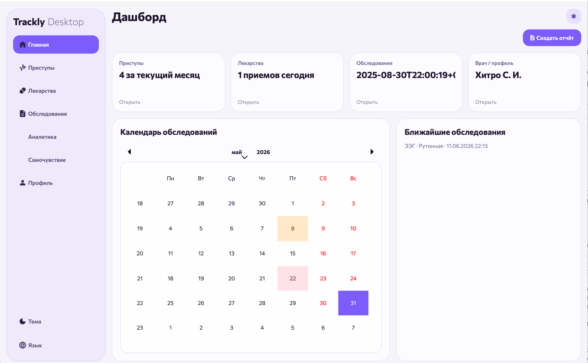

<div align="center">


# Trackly — публичный сайт

**Статический сайт проекта Trackly — приложения для мониторинга эпилепсии.**

[](https://developer.mozilla.org/docs/Web/HTML)
[](https://developer.mozilla.org/docs/Web/CSS)
[](https://developer.mozilla.org/docs/Web/JavaScript)
[](https://supabase.com/)

[](LICENSE)
[](https://pages.github.com/)
[](https://github.com/jaraslaukunin/trackly-site)

**[О проекте](#о-проекте)** · [Страницы](#страницы) · [Локализация](#локализация) · [Быстрый старт](#быстрый-старт) · [Структура проекта](#структура-проекта) · [Лицензия](#лицензия)

</div>

---

## О проекте

**Trackly** — персональное приложение для наблюдения за эпилепсией: дневник приступов, учёт препаратов, записи о самочувствии, обследования и отчёты для врача. Само приложение — проприетарный продукт для macOS и Windows; его исходники в этот репозиторий не входят.

Здесь лежит **публичный сайт проекта** на [tracklyapp.xyz](https://tracklyapp.xyz). На нём три вещи: короткое описание продукта, юридические документы, на которые приложение ссылается при регистрации и входе, и страница статуса инфраструктуры. Сайт статический — HTML, CSS и JavaScript без сборки и зависимостей, размещён на GitHub Pages.

Документы описывают реальную инфраструктуру: Supabase PostgreSQL в регионе AWS eu-west-1 (Ирландия), Supabase Edge Functions, доставку писем через Resend, домен у hoster.by и DNS Cloudflare. Сама страница статуса обращается к Edge Function `/status` и показывает ответ как есть.

> Trackly не является медицинским изделием и не заменяет консультацию врача. Это курсовой проект; сервис предназначен для личного учёта и подготовки информации для медицинской консультации.

## Превью



Скриншот десктопного приложения Trackly — не часть сайта, а иллюстрация продукта, для которого он сделан.

## Страницы

| Файл | Что содержит |
|---|---|
| `index.html` | Главная: описание продукта, четыре возможности, безопасность и инфраструктура, ссылки на документы, контакты |
| `privacy.html` | Политика конфиденциальности: правовые основания, состав данных, цели, инфраструктура, сроки хранения, права пользователя, отзыв согласия |
| `consent.html` | Согласие на обработку персональных данных — текст, который принимается чекбоксом при регистрации |
| `terms.html` | Условия использования сервиса |
| `status.html` | Статус сервиса: состояние компонентов и health-check через Supabase Edge Functions |

## Возможности

| Возможность | Детали |
|---|---|
| Четыре языка | RU, EN, BY и BE переключаются кнопками без перезагрузки страницы |
| Сохранение языка | Выбор хранится в `localStorage` под ключом `trackly-lang`; при отсутствии значения используется русский |
| Локализация документов | Политика, согласие и условия переведены на все четыре языка, включая заголовок вкладки |
| Статус сервиса | Запрос к Edge Function `/status`, разбор JSON, показ HTTP-статуса, времени проверки и региона функции |
| Ручная перепроверка | Кнопка «Перепроверить статус» повторяет запрос с `cache: 'no-store'` |
| Компоненты | Клиентские приложения, Supabase API и БД, Resend, сайт и документация |
| Адаптивность | Одна колонка на мобильных, сетки карточек на широких экранах |
| Без зависимостей | Нет `package.json`, сборщика, CDN и внешних шрифтов — только локальные файлы |

Переключатель языка есть на главной и всех трёх юридических страницах. `status.html` — только на русском: у неё нет блока переводов и кнопок RU/EN/BY/BE.

## Локализация

| Код | Язык | Примечание |
|---|---|---|
| `RU` | Русский | Язык по умолчанию |
| `EN` | English | Полный перевод интерфейса и документов |
| `BY` | Беларуская | Афіцыйная арфаграфія |
| `BE` | Беларуская (лацінка) | Тарашкевіца ў лацінскім запісе |

При переключении обновляются тексты с `data-i18n`, `document.title` и атрибут `lang` у `<html>`. Для `BY` и `BE` выставляется `lang="be"`, для остальных — код выбранного языка. Переводы лежат прямо в каждом HTML-файле, отдельного JSON со словарями нет.

## Технологии

- **HTML5 + CSS3 + JavaScript** — вся вёрстка, стили и переводы внутри страниц; сборка не нужна.
- **GitHub Pages** — хостинг статики; домен задаётся файлом `CNAME`.
- **Supabase Edge Functions** — health-check `/status`; страница статуса обращается к функции напрямую из браузера.
- **Supabase** — PostgreSQL, Edge Functions и авторизация; по документам база размещена в AWS eu-west-1 (Ирландия).
- **Resend** — транзакционные и экстренные письма; по документам также в AWS eu-west-1.
- **hoster.by + Cloudflare** — регистратор домена и DNS-записи для почтовой инфраструктуры.

## Статус-страница

Страница запрашивает публичный эндпоинт:

```text
https://kiaobwhpghbmzjlfbybz.supabase.co/functions/v1/status
```

Из ответа используются:

| Поле | Что показывает |
|---|---|
| `ok` | Общий статус; если поля нет, берётся `response.ok` |
| `checks.database.ok` | Доступность базы данных |
| `checks.database.error` | Текст ошибки, если база недоступна |
| `meta.startedAt`, `meta.endedAt` | Время начала и завершения проверки |
| `meta.region` | Регион Edge Function |

Сырой ответ выводится в блоке «Детали health-check». Если запрос не удался, страница показывает «Не удалось получить статус Trackly» и подсказывает проверить сеть или Supabase Functions. Список инцидентов за 30 дней статический и заполняется вручную.

## Быстрый старт

Устанавливать нечего: зависимостей и сборки нет. Откройте `index.html` в браузере или поднимите локальный сервер из корня репозитория:

```bash
python3 -m http.server 8080
```

или

```bash
npx serve .
```

После этого сайт доступен на `http://localhost:8080` (или на порту, который предложит `serve`). Для страницы статуса нужен доступ в интернет: она делает запрос к Supabase.

## Структура проекта

```text
index.html              # главная страница
privacy.html            # политика конфиденциальности
consent.html            # согласие на обработку персональных данных
terms.html              # условия использования
status.html             # статус сервиса и health-check
CNAME                   # tracklyapp.xyz
logo.png                # логотип, 2048×2048
logo_small.svg          # компактный логотип в шапке страниц
logo_transparent.svg    # версия логотипа без фона
app_preview.png         # скриншот десктопного приложения
README.md
```

Отдельных папок с CSS, JS или изображениями нет: стили и скрипты встроены в HTML, картинки лежат в корне. `logo_small.svg` подключён в шапке главной и юридических страниц; `logo.png` и `logo_transparent.svg` — дополнительные версии логотипа.

## Деплой

Репозиторий не содержит CI-пайплайна: файлы публикуются на GitHub Pages как есть. Домен `tracklyapp.xyz` закреплён файлом `CNAME`; HTTPS на Pages включается в настройках репозитория. Чтобы обновить сайт, достаточно запушить изменения в ветку, из которой раздаётся статика.

## Правовая информация

Оператор — Кунин Ярослав Вадимович, контакт: [jaraslaukunin@gmail.com](mailto:jaraslaukunin@gmail.com). Документы описывают состав и цели обработки данных, передачу Supabase и Resend, хранение за пределами Беларуси, сроки хранения, права пользователя и порядок отзыва согласия.

## Лицензия

Код сайта распространяется по лицензии [MIT](LICENSE). Лицензия относится только к этому сайту: само приложение Trackly остаётся проприетарным, его исходники сюда не входят.

---

<div align="center">

**[tracklyapp.xyz](https://tracklyapp.xyz)** · репозиторий **[trackly-site](https://github.com/jaraslaukunin/trackly-site)**

Если сайт или документы оказались полезны, поставьте репозиторию ⭐

</div>
